<div align="center">

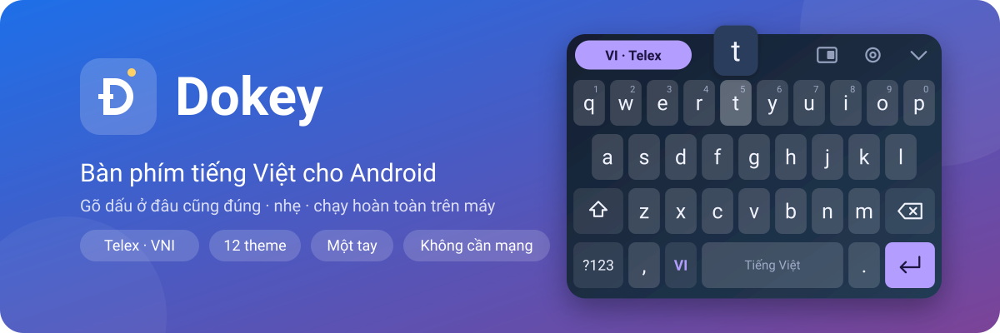

# Dokey – Bàn phím tiếng Việt cho Android

**Gõ tiếng Việt Telex, VNI · 22 theme · Material You · không cần Internet**


**[⬇ Tải Dokey mới nhất](https://github.com/dhtoan/Dokey-Android/releases/latest)** ·
[Tính năng](#tính-năng) · [Theme](#22-theme-và-ảnh-nền) · [Cách dùng](#cách-dùng) · [Cài đặt](#cài-đặt) ·
[Hỏi đáp](#hỏi-đáp) · [English](#english)

</div>

---

**Dokey** là bàn phím tiếng Việt (bộ gõ tiếng Việt) cho điện thoại Android, anh em với Dokey trên macOS và Windows. Gõ Telex hoặc VNI, đặt dấu
đúng chính tả dù gõ dấu ở bất kỳ đâu trong từ, tự nhận ra từ tiếng Anh để không thêm dấu bừa, và có 22 theme,
4 kiểu phím và theme bằng ảnh của chính bạn. Mọi thứ chạy trên máy: ứng dụng **không xin quyền truy cập Internet**.

<div align="center">
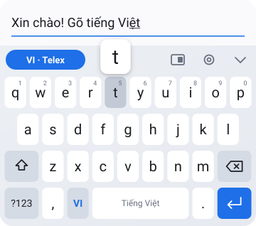&nbsp;&nbsp;
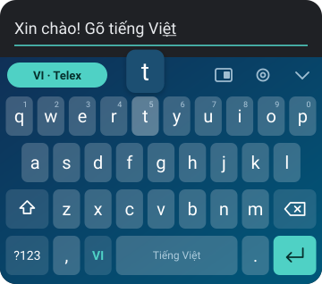
<br>
<sub>Ảnh trong trang này là ảnh minh hoạ, vẽ từ đúng bảng màu và bố cục phím trong mã nguồn
(<code>scripts/mockups.py</code>), không phải ảnh chụp từ điện thoại.</sub>
</div>

## Trạng thái

> [!IMPORTANT]
> **Dokey 0.3.0 chưa được thử trên điện thoại thật.** Nếu gặp lỗi, hãy ghi lại ứng dụng đang
> dùng và các phím đã gõ.

| Phần | Đã kiểm chứng bằng |
|---|---|
| Bộ gõ Telex/VNI | Unit test (`engine/src/test`), đều qua |
| Build APK | Build thành công; APK đính kèm ở mỗi bản phát hành |
| Màn hình cài đặt | Mở và hiển thị được trên trình giả lập Android 14 |
| Bàn phím: vẽ phím, chạm, rung, theme, một tay | **Chưa kiểm chứng** – chưa ai cài và gõ thử |
| Theme mới, kiểu phím, ảnh nền (0.2) | Biên dịch được, có trong APK; **chưa thử trên máy** |
| Gợi ý từ, gõ vuốt, gõ tắt (0.3) | Unit test cho từ điển, gợi ý, gõ vuốt, gõ tắt; **chưa thử trên máy** |
| Vẽ dấu, emoji, bộ nhớ tạm (0.3) | Biên dịch được; **chưa kiểm chứng** cách nhận dạng nét vẽ trên máy thật |

## Tính năng

### Gõ tiếng Việt thông minh
- **Telex và VNI**, chọn bỏ dấu kiểu mới (*hoà, thuý*) hoặc kiểu cũ (*hòa, thúy*).
- **Gõ dấu ở đâu cũng được**: `tieesng` hay `tieengs` đều ra *tiếng*; dấu luôn nằm đúng chỗ theo chính tả.
- **Gõ lặp để bỏ dấu**: `ass` → *as*, `aaa` → *aa*, `ww` → *w*. Telex: `w` đứng riêng → *ư*.
- **Giữ nguyên từ tiếng Anh**: *class, google, Windows, user* không bị thêm dấu (tắt được).
- **Tự gõ không dấu** trong ô mật khẩu, e-mail, URL và ô số.

| Bạn gõ (Telex) | Ra | Bạn gõ (VNI) | Ra |
|---|---|---|---|
| `vieetj` | việt | `vie65t` | việt |
| `nguwowif` | người | `nguo7i2` | người |
| `dduwowngf` | đường | `d9uo7ng2` | đường |
| `hoawcj` | hoặc | `hoa2` | hoà |
| `khuyur` | khuỷu | `a8n` | ăn |
| `google` | google | `Covid19` | Covid19 |

### Gợi ý, gõ vuốt và gõ tắt
- **Gợi ý từ**: gõ không dấu vẫn được gợi ý có dấu (`duoc` → *được*, *dược*), gợi ý tiếng đang gõ dở
  (`nguo` → *người*) và đoán tiếng tiếp theo (*quy* → *định*). Chạm để chọn.
- **Gõ vuốt**: vuốt qua các chữ cái của một tiếng (không cần dấu), nhấc tay là Dokey chèn tiếng có dấu phù hợp
  nhất; các lựa chọn khác hiện trên thanh gợi ý.
- **Gõ tắt**: `ko` → *không*, `dc` → *được*, `vs` → *với*, `ntn` → *như thế nào*… Tự sửa danh sách trong cài đặt.
- **Vẽ dấu**: vuốt lên từ phím cách để thêm dấu cho tiếng đang gõ (hoặc tiếng vừa gõ):
  chéo phải **sắc**, chéo trái **huyền**, thẳng lên **hỏi**, lượn sóng **ngã**, lên rồi xuống **nặng**.
- **Emoji** theo 9 nhóm, có mục dùng gần đây. **Bộ nhớ tạm** giữ 25 mục sao chép gần nhất, chạm để dán.

Từ điển gợi ý (3.374 tiếng, 20.123 cặp tiếng) được Dokey tự đếm từ văn bản không thuộc diện bảo hộ quyền tác giả:
văn bản pháp luật Việt Nam, Truyện Kiều, Lục Vân Tiên, Tắt đèn, Hà Nội băm sáu phố phường và Nam Phong tạp chí
(`scripts/fetch_corpus.py`, `scripts/build_dictionary.py`). Vì văn bản luật chiếm phần lớn, gợi ý còn thiên về
từ trang trọng.

### Bàn phím
- QWERTY, trang số – ký hiệu (có **₫**), trang ký hiệu thứ hai, bàn phím số cho ô số và điện thoại.
- **Phóng to phím khi nhấn**, **rung** chỉnh được độ mạnh, âm thanh gõ.
- Phím Enter đổi biểu tượng theo ô nhập: tìm kiếm, gửi, tiếp, xong.
- **Chế độ một tay** (trái/phải), 3 mức chiều cao phím, bật/tắt viền phím, hàng số riêng.
- Thanh công cụ: nút VI/EN, chế độ một tay, cài đặt, ẩn bàn phím.

<div align="center">
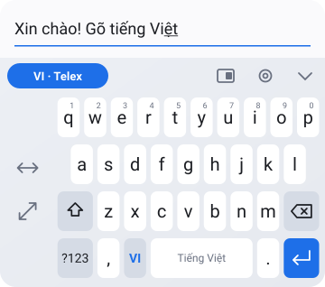
<br><sub>Chế độ một tay: bàn phím thu về một bên, có nút đổi bên và nút trở lại cỡ đầy đủ.</sub>
</div>

## 22 theme và ảnh nền

Theme được chia thành nhóm trong màn hình cài đặt, mỗi theme có hình xem trước theo đúng kiểu phím đang chọn.

### Cơ bản

Ngoài Material You (màu theo hình nền, Android 12+) và Theo hệ thống (tự đổi sáng/tối):

<table>
<tr>
<td align="center"><br><b>Sáng</b></td>
<td align="center">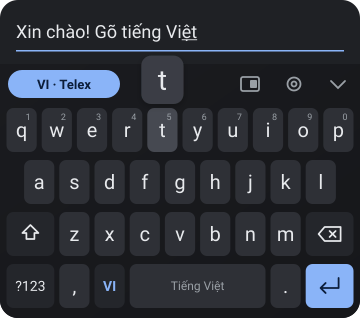<br><b>Tối</b></td>
<td align="center">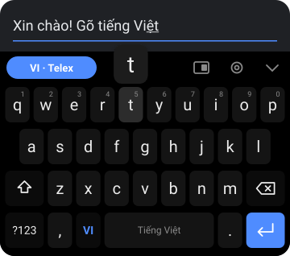<br><b>Đen AMOLED</b></td>
</tr>
</table>

### Màu sắc

<table>
<tr>
<td align="center"><br><b>Đại dương</b></td>
<td align="center">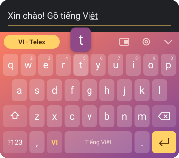<br><b>Hoàng hôn</b></td>
<td align="center">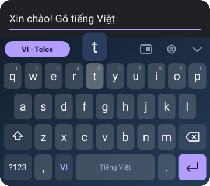<br><b>Đêm sao</b></td>
</tr>
<tr>
<td align="center">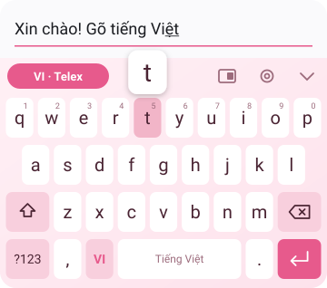<br><b>Hoa anh đào</b></td>
<td align="center">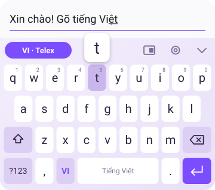<br><b>Oải hương</b></td>
<td align="center">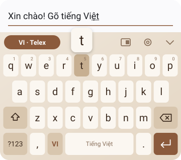<br><b>Cà phê sữa</b></td>
</tr>
<tr>
<td align="center">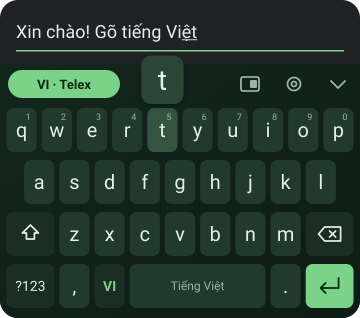<br><b>Rừng thông</b></td>
<td align="center">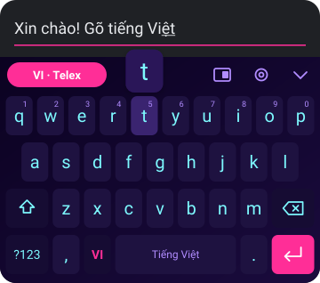<br><b>Neon</b></td>
<td align="center">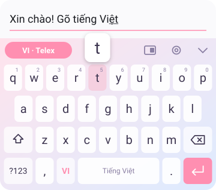<br><b>Kẹo ngọt</b></td>
</tr>
<tr>
<td align="center">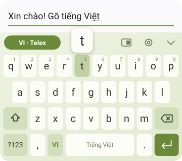<br><b>Trà xanh</b></td>
<td></td>
<td></td>
</tr>
</table>

### Việt Nam

Lấy cảm hứng từ những cảnh quen thuộc – chỉ dùng màu, không dùng ảnh của ai.

<table>
<tr>
<td align="center">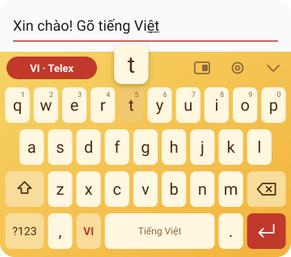<br><b>Phố cổ Hội An</b></td>
<td align="center">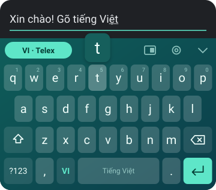<br><b>Vịnh Hạ Long</b></td>
<td align="center">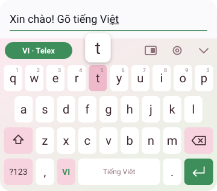<br><b>Sen hồng</b></td>
</tr>
<tr>
<td align="center">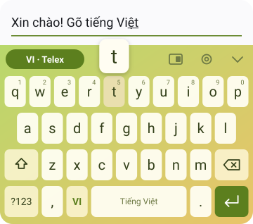<br><b>Đồng lúa</b></td>
<td></td>
<td></td>
</tr>
</table>

### Lễ hội

<table>
<tr>
<td align="center">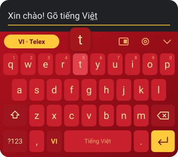<br><b>Tết</b></td>
<td align="center">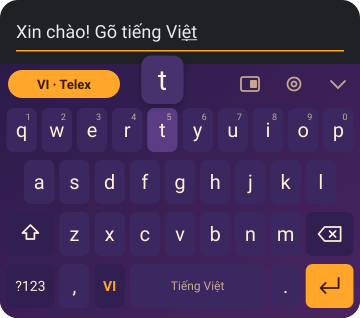<br><b>Trung thu</b></td>
<td align="center">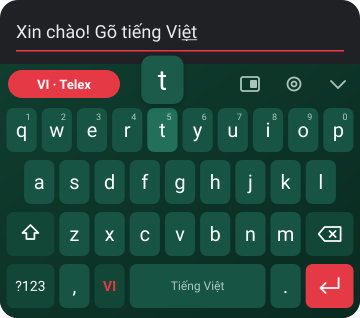<br><b>Giáng sinh</b></td>
</tr>
</table>

### Ảnh của bạn

Chọn một ảnh trong máy làm nền bàn phím. Ảnh được thu nhỏ và lưu trong bộ nhớ riêng của Dokey, không gửi đi đâu.
Có thanh **Làm tối ảnh** (0–80%) để chữ trên phím luôn dễ đọc; phím chuyển sang kiểu kính mờ.

## 4 kiểu phím

<table>
<tr>
<td align="center">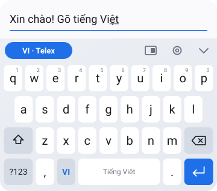<br><b>Phẳng</b></td>
<td align="center">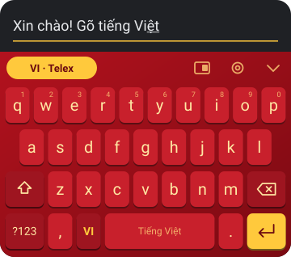<br><b>Phím nổi</b></td>
</tr>
<tr>
<td align="center">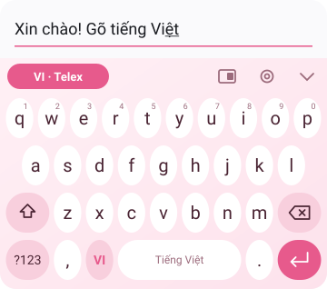<br><b>Bo tròn</b></td>
<td align="center">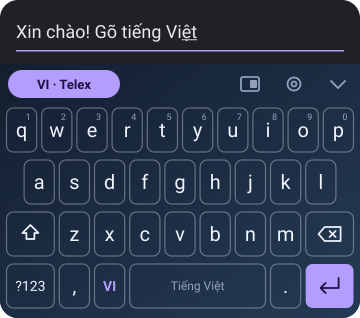<br><b>Viền mảnh</b></td>
</tr>
</table>

Kiểu phím dùng được với mọi theme (ảnh trên lần lượt là theme Sáng, Tết, Hoa anh đào, Đêm sao).

## Cách dùng

| Thao tác | Kết quả |
|---|---|
| Chạm **VI/EN** (cạnh phím cách hoặc trên thanh công cụ) | Bật/tắt gõ tiếng Việt |
| Giữ phím hàng trên | Gõ số 1–0 |
| Giữ `a` · `e` · `o` · `u` · `d` | Chọn â ă · ê · ô ơ · ư · đ |
| Giữ `,` hoặc `.` | Dấu câu khác (? ! ; : …) |
| Chạm **Shift** một lần / hai lần | Viết hoa một chữ / khoá chữ hoa |
| Chạm dấu cách hai lần | Thêm dấu chấm và dấu cách |
| Vuốt ngang trên phím cách | Di chuyển con trỏ |
| Giữ phím cách | Đổi sang bàn phím khác |
| Giữ **Xoá** | Xoá liên tục |
| Vuốt qua các chữ cái | Gõ vuốt một tiếng |
| Vuốt lên từ phím cách | Vẽ dấu: ↗ sắc · ↖ huyền · ↑ hỏi · lượn sóng ngã · lên rồi xuống nặng |
| Chạm 🙂 / 📋 trên thanh công cụ | Mở emoji / bộ nhớ tạm |

## So với các bàn phím khác

Chỉ so trên những gì Dokey đang có; Gboard và Laban Key còn nhiều tính năng mà Dokey chưa có (sticker, giọng nói, GIF).

| | Dokey 0.3 | Gboard | Laban Key |
|---|:-:|:-:|:-:|
| Telex và VNI | ✓ | ✓ | ✓ |
| Gõ dấu ở bất kỳ đâu trong từ | ✓ | ? | ✓ |
| Giữ nguyên từ tiếng Anh | ✓ | ? | ✓ |
| Theme Material You | ✓ | ✓ | ? |
| Chế độ một tay | ✓ | ✓ | ? |
| Không xin quyền Internet | ✓ | – | ? |
| Gợi ý từ, gõ vuốt, emoji | ✓ | ✓ | ✓ |
| Vẽ dấu bằng cử chỉ | ✓ | ? | ✓ |

<sub>“?” là chưa kiểm chứng. Thông tin về Gboard và Laban Key lấy từ khảo sát tháng 10/2026
([docs/research.md](docs/research.md)) và có thể đã thay đổi.</sub>

## Cài đặt

1. Mở [bản phát hành mới nhất](https://github.com/dhtoan/Dokey-Android/releases/latest) và tải file
   `dokey-android-…-debug.apk`.
2. Cài file APK (Android sẽ hỏi cho phép cài từ nguồn không xác định).
3. Mở ứng dụng **Dokey** → **Bật Dokey** → **Chọn bàn phím**.
4. Gõ thử ngay trong ô **Thử bàn phím** ở cuối màn hình cài đặt.

## Quyền riêng tư

Dokey chỉ xin **một quyền: rung**. Không có quyền Internet, nên những gì bạn gõ không thể bị gửi đi đâu.
Cài đặt được lưu trong bộ nhớ riêng của ứng dụng trên máy.

## Hỏi đáp

**Vì sao từ đang gõ có gạch chân?**
Dokey hiển thị từ đang gõ dưới dạng *composing text* để có thể sửa dấu cho cả từ. Gạch chân mất khi gõ dấu cách
hoặc dấu câu. Có ứng dụng không hiện gạch chân.

**Gõ tiếng Anh bị thêm dấu?**
Bật *Giữ nguyên từ tiếng Anh* trong cài đặt (mặc định đã bật), hoặc chạm VI/EN để chuyển sang tiếng Anh.
Từ hợp lệ trong cả hai ngôn ngữ, như *test* → *tét*, vẫn bị thêm dấu khi đang gõ tiếng Việt.

**Cài bản mới bị báo lỗi chữ ký?**
Các bản hiện tại là bản debug, ký bằng khoá tạm. Gỡ bản cũ rồi cài bản mới.

**Có bản cho iPhone không?**
Chưa. Bộ gõ được viết bằng Kotlin thuần nên có thể dùng lại cho iOS bằng Kotlin Multiplatform, nhưng giao diện
bàn phím iOS phải viết lại bằng Swift.

## Lộ trình

- [x] Telex, VNI, gõ dấu tự do, giữ nguyên từ tiếng Anh
- [x] 12 theme, chế độ một tay, rung, phóng to phím, ký tự phụ
- [x] 22 theme theo nhóm, 4 kiểu phím, theme ảnh nền (0.2.0)
- [x] Gợi ý từ, gõ vuốt, gõ tắt, vẽ dấu, emoji, bộ nhớ tạm (0.3.0)
- [ ] Từ điển gợi ý theo văn nói đời thường
- [ ] Sticker, nhập bằng giọng nói
- [ ] Thử trên điện thoại thật (Zalo, Messenger, Chrome)
- [ ] Bản release ký bằng khoá cố định

## Nhật ký thay đổi

**0.3.0** (03/11/2026) – gợi ý từ tiếng Việt (gõ không dấu ra có dấu, đoán tiếng tiếp theo), gõ vuốt, gõ tắt,
vẽ dấu trên phím cách, bảng emoji, bộ nhớ tạm.

**0.2.0** (03/11/2026) – thêm 10 theme (Neon, Kẹo ngọt, Trà xanh, Phố cổ Hội An, Vịnh Hạ Long,
Sen hồng, Đồng lúa, Tết, Trung thu, Giáng sinh), chia theme thành nhóm, 4 kiểu phím (phẳng, phím nổi, bo tròn,
viền mảnh), theme bằng ảnh của bạn.

**0.1.0** (29/10/2026) – bản đầu tiên: bộ gõ Telex/VNI, bàn phím QWERTY và ký hiệu, 12 theme, chế độ một tay,
rung và âm thanh, màn hình cài đặt.

## Dành cho nhà phát triển

```
engine/   Bộ gõ tiếng Việt – Kotlin thuần, không phụ thuộc Android, có unit test
app/      InputMethodService, bàn phím vẽ bằng Canvas, màn hình cài đặt Jetpack Compose
docs/     Khảo sát, ảnh minh hoạ
scripts/  mockups.py (vẽ ảnh minh hoạ), screenshots.sh (chụp ảnh trên trình giả lập)
```

- **Bộ gõ viết mới** từ quy tắc chính tả tiếng Việt công khai, không dựa trên mã nguồn bộ gõ nào khác.
  Mỗi phím gõ, cả từ được dựng lại từ các phím đã gõ, nên dấu luôn nằm đúng chỗ.
- **Bàn phím là View tự vẽ** (không dùng Compose) để mở nhanh và nhẹ trên máy yếu; Compose chỉ dùng cho cài đặt.

Build cần JDK 17, Gradle 8.9 và Android SDK (compileSdk 35):

```bash
gradle :engine:test :app:assembleDebug
```

Vẽ lại ảnh minh hoạ sau khi sửa màu theme:

```bash
python3 scripts/mockups.py
```

## English

**Dokey is a Vietnamese keyboard for Android** (a Vietnamese input method / IME). It supports the two common
Vietnamese typing methods, **Telex** and **VNI**, places tone marks by the spelling rules wherever you type them
in a word, and leaves English words like *class* or *google* untouched. It comes with 22 themes (including
Material You and themes inspired by Vietnam and its festivals), 4 key styles, a photo background, one-handed mode,
haptics and key popups, plus word suggestions (type without marks, get the marked word), swipe typing,
text shortcuts, tone gestures, emoji and clipboard history. It works fully offline: the app does not request Internet access.
Written in Kotlin; the typing engine is a standalone Kotlin module with unit tests.
Status: early (0.3.0), not yet tested on a real device.

## Giấy phép

Bản quyền © 2026 Do Huy Toan. **Mọi quyền được bảo lưu.** Nghiêm cấm sao chép, sửa đổi, phân phối hoặc phát hành
lại Dokey dưới mọi hình thức khi chưa có sự đồng ý bằng văn bản của tác giả. Bạn được tải bản phát hành chính
thức về cài và dùng cho cá nhân. Xem [LICENSE](LICENSE).
